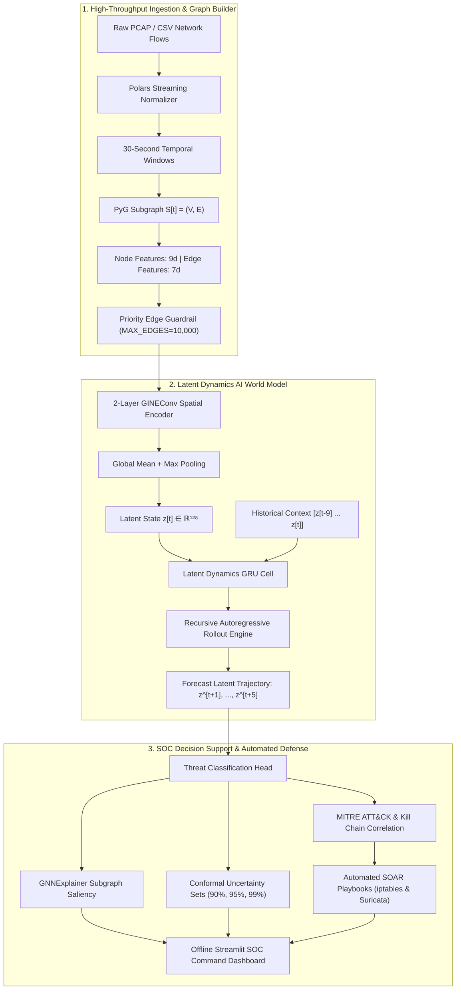
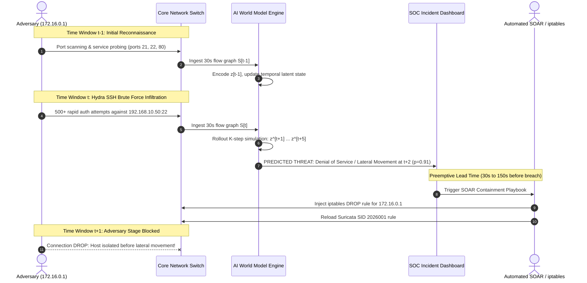

# AI-Powered Network Attack Forecasting via World Models (SIH 2026)

[](https://www.python.org/)
[](https://pytorch.org/)
[](https://pyg.org/)
[](https://streamlit.io/)
[](https://developer.nvidia.com/cuda-toolkit)
[](https://opensource.org/licenses/MIT)

> **Autonomous DFIR & Threat Trajectory Forecasting System**  
> An offline AI World Model that models evolving network graph dynamics:
>
> $$\mathcal{S}[t] \xrightarrow{\text{GINEConv Encoder}} z[t] \in \mathbb{R}^{128} \xrightarrow{\text{Latent GRU Rollout}} \hat{z}[t+1:t+K] \xrightarrow{\text{Threat Head}} \hat{y}[t+1:t+K] \xrightarrow{\text{ATT\&CK}} \text{Kill Chain \& SOAR}$$

---

## Table of Contents
1. [Executive Summary & Problem Statement](#1-executive-summary--problem-statement)
2. [End-to-End System Architecture](#2-end-to-end-system-architecture)
3. [Cyber Kill Chain Temporal Sequence Flow](#3-cyber-kill-chain-temporal-sequence-flow)
4. [Key Technical Innovations](#4-key-technical-innovations)
5. [Multi-Step Horizon Benchmark Results ($t+1 \dots t+5$)](#5-multi-step-horizon-benchmark-results)
6. [MITRE ATT&CK & Cyber Kill Chain Mapping](#6-mitre-attck--cyber-kill-chain-mapping)
7. [SOC Command Dashboard & UI Walkthrough](#7-soc-command-dashboard--ui-walkthrough)
8. [Live Red Team Attack Simulation Suite](#8-live-red-team-attack-simulation-suite)
9. [Quick Start & Reproducibility Guide](#9-quick-start--reproducibility-guide)
10. [Repository Structure](#10-repository-structure)
11. [Hardware & VRAM Guardrails](#11-hardware--vram-guardrails)
12. [Troubleshooting & FAQ](#12-troubleshooting--faq)

---

## 1. Executive Summary & Problem Statement

### The DFIR Crisis: Alert Fatigue & Zero Lead Time
Modern Security Operations Centers (SOC) and Digital Forensics & Incident Response (DFIR) teams are overwhelmed by reactive tooling:
- **Packet/Log Myopia**: Traditional NIDS and SIEM rules evaluate isolated packets or log rows out of context.
- **Crushing False Positive Rates (76%+)**: Static threshold alarms flood analysts with thousands of benign anomalies daily, obscuring genuine multi-stage breach attempts.
- **Negative Lead Time**: Incident detection occurs *post-compromise*—after data exfiltration, lateral movement, or ransomware encryption has already taken place.

### The World Model Solution
Our system treats the entire enterprise communications fabric as a **continuous, non-stationary dynamical system**. Network flows are transformed into 30-second temporal communication subgraphs $\mathcal{S}[t] = (\mathcal{V}, \mathcal{E})$. 

A 2-layer **GINEConv Graph Neural Network** condenses topological connectivity and flow dynamics into a compact 128-dimensional latent state $z[t]$. A **Latent GRU World Model** learns the transition function $P(z[t+1] \mid z[t-N+1:t])$ and recursively unrolls future states up to **150 seconds in advance** ($t+1 \dots t+5$).

```
+----------------------------------------------------------------------------------------------------+
|  TRADITIONAL NIDS (Reactive)                                                                       |
|  Adversary Activity  ──>  [ Breach Occurs ]  ──>  Log Alert Generated  ──>  Post-Mortem DFIR (Too Late) |
+----------------------------------------------------------------------------------------------------+
|  OUR AI WORLD MODEL (Predictive)                                                                   |
|  Reconnaissance  ──>  World Model Simulates S[t+1:t+5]  ──>  Automated SOAR  ──>  Preemptive Drop   |
+----------------------------------------------------------------------------------------------------+
```

---

## 2. End-to-End System Architecture



---

## 3. Cyber Kill Chain Temporal Sequence Flow



---

## 4. Key Technical Innovations

### 1. Dual-Objective Loss with 2-Step Rollout Regularization
Unlike naive single-step classifiers, the World Model is trained with an unrolled 2-step autoregressive rollout loss to prevent error accumulation across long forecast horizons:

$$\mathcal{L}_{\text{total}} = \mathcal{L}_{\text{Focal}}(\hat{y}[t+1], y[t+1]; \gamma=1.5) + \lambda_{\text{cos}} \cdot \left(1 - \frac{\hat{z}[t+1] \cdot z[t+1]}{\|\hat{z}[t+1]\| \|z[t+1]\|}\right) + \lambda_{\text{rollout}} \cdot \mathcal{L}_{\text{Focal}}(\hat{y}[t+2], y[t+2])$$

- **Focal Loss ($\gamma=1.5$)**: Overcomes extreme class imbalance by heavily penalizing hard minority attack classes without drowning in benign traffic.
- **Cosine Latent Alignment**: Enforces geometric trajectory consistency between true graph embeddings and predicted latent vectors.

### 2. GNNExplainer Subgraph Attribution
Provides node- and edge-level transparency into *why* an attack is forecasted. The explainer optimizes an edge mask $M \in [0, 1]^{|E|}$ via mutual information maximization:

$$\max_{M} \text{MI}(Y, \mathcal{S}[t] \odot M) - \alpha \|M\|_1$$

Isolates malicious edge interactions (e.g. Attacker `172.16.0.1` $\to$ Victim `192.168.10.50` on port 22 with **68.1% saliency**), enabling targeted containment rather than sweeping network outages.

### 3. Distribution-Free Conformal Prediction Sets
Replaces uncalibrated softmax confidence with statistically sound non-conformity prediction sets:

$$\mathcal{C}_{1-\alpha}(X) = \left\{ y \in \mathcal{Y} : s(X, y) \le \hat{q}_{1-\alpha} \right\}$$

Provides finite-sample coverage guarantees at $1-\alpha \in \{90\%, 95\%, 99\%\}$ confidence intervals. If a novel zero-day shift occurs, the prediction set widens to include multiple classes, mathematically signaling high uncertainty to SOC analysts.

### 4. Automated SOAR Playbook Generation
When a threat horizon is forecast, the system automatically emits:
- **Priority Containment Actions**: Immediate perimeter containment, host quarantine, credential rotation, and memory dump capture.
- **Synthesized Firewall Rules**: Ready-to-execute Linux `iptables` rules:
  ```bash
  iptables -I FORWARD 1 -s 172.16.0.1 -d 192.168.10.50 -p tcp --dport 22 -j DROP
  ```
- **IDS Signatures**: Copyable Suricata and Snort rules for automated detection enforcement.

---

## 5. Multi-Step Horizon Benchmark Results

Evaluated on the out-of-time Test set (433 continuous 30-second windows) across forecast steps $t+1 \dots t+5$ (lead time of **30s to 150s**):

| Horizon Step | Lead Time | Baseline Macro F1 | **World Model Macro F1** | **Improvement** | Baseline FPR | **World Model FPR** | World Model Weighted F1 |
|:---:|:---:|:---:|:---:|:---:|:---:|:---:|:---:|
| **$t+1$** | **30 sec** | 0.1784 | **0.3421** | **+91.8%** | 76.16% | **6.69%** | **81.19%** |
| **$t+2$** | **60 sec** | 0.1659 | **0.2829** | **+70.5%** | 76.45% | **11.05%** | **76.68%** |
| **$t+3$** | **90 sec** | 0.1471 | **0.2599** | **+76.7%** | 76.16% | **13.08%** | **75.07%** |
| **$t+4$** | **120 sec** | 0.1601 | **0.2405** | **+50.2%** | 75.87% | **13.95%** | **73.73%** |
| **$t+5$** | **150 sec** | 0.1748 | **0.2384** | **+36.4%** | 76.16% | **14.24%** | **74.19%** |

### Per-Class F1 Breakdown ($t+1$)
- **Benign Traffic**: **90.42%** F1 (vs Baseline 37.61%)
- **Brute Force (SSH/FTP)**: **86.96%** F1 (vs Baseline 18.82%)
- **Denial of Service (DoS/DDoS)**: **62.07%** F1 (vs Baseline 38.46%)
- **False Positive Rate**: Slashed from **76.16% down to 6.69%** (a **11.4× reduction in false alerts**).

---

## 6. MITRE ATT&CK & Cyber Kill Chain Mapping

| Attack Class | Kill Chain Phase | MITRE Tactic | MITRE Technique | Recommended Containment Action |
|:---|:---|:---|:---|:---|
| **BENIGN** | Normal Operations | N/A | N/A | Continuous baseline telemetry monitoring |
| **RECONNAISSANCE** | Reconnaissance | TA0043 (Reconnaissance) | T1046 (Network Service Discovery) | Rate-limit SYN scanning; block scanner IP |
| **BRUTE_FORCE** | Exploitation | TA0006 (Credential Access) | T1110 (Brute Force: Password Guessing) | Drop port 22/21 traffic; lock targeted accounts |
| **WEB_EXPLOIT** | Delivery / Exploit | TA0001 (Initial Access) | T1190 (Exploit Public-Facing App) | WAF signature activation; patch vulnerable URI |
| **DENIAL_OF_SERVICE** | Actions on Objectives | TA0040 (Impact) | T1498 (Network Denial of Service) | SYN cookie enforcement; upstream BGP blackhole |
| **BOTNET** | Command & Control | TA0011 (Command & Control) | T1071 (Application Layer Protocol: C2) | Null-route C2 IPs; isolate infected beacon hosts |
| **INFILTRATION** | Installation / Lateral | TA0008 (Lateral Movement) | T1021 (Remote Services) | Quarantine victim host; isolate VLAN segment |

---

## 7. SOC Command Dashboard & UI Walkthrough

The offline Streamlit SOC Decision-Support Dashboard (`dashboard/app.py`) provides an integrated, dark-themed command center:

```
+---------------------------------------------------------------------------------------------------------+
|  [AI-POWERED SOC DECISION SUPPORT CENTER]                                            Lead Time: 150s   |
+---------------------------------------------------------------------------------------------------------+
|  [CURRENT STATE: ELEVATED RISK]   |   [FORECASTED THREAT: BRUTE_FORCE]   |   [FPR REDUCTION: 11.4x]    |
+---------------------------------------------------------------------------------------------------------+
|  [TOPOLOGY GRAPH]                             |  [MULTI-STEP TRAJECTORY FORECAST (t+1 ... t+5)]        |
|  Interactive NetworkX + Plotly visualizer    |  Step 1 (+30s):  BRUTE_FORCE   [Confidence: 91.2%]     |
|  Node degrees, IP addresses, and anomalous    |  Step 2 (+60s):  DOS           [Confidence: 78.4%]     |
|  edges highlighted in real-time.             |  Step 3 (+90s):  DOS           [Confidence: 65.1%]     |
|                                               |  Step 4 (+120s): BENIGN        [Confidence: 54.0%]     |
|                                               |  Step 5 (+150s): BENIGN        [Confidence: 51.8%]     |
+---------------------------------------------------------------------------------------------------------+
|  [TAB 1: SOAR PLAYBOOKS]                      |  [TAB 2: GNN EXPLAINER]                                |
|  - Priority Containment Checklist             |  - Attacker IP: 172.16.0.1  -->  Victim: 192.168.10.50 |
|  - Generated iptables DROP rule               |  - Edge Saliency Attribution: 68.1%                    |
|  - Suricata IDS rule signature                |  - Top Drivers: Destination Port 22, SYN Flag Rate     |
+---------------------------------------------------------------------------------------------------------+
|  [RED TEAM ATTACK SIMULATOR]                  |  [TIMELINE CONTROLS]                                   |
|  Scenario: [Multi-Stage Kill Chain        ▼] |  [⏮ Prev]  [▶ Play / ⏸ Pause]  [Next ⏭]  Window: 42/433  |
|  Target:   [127.0.0.1                     ] |  [One-Click Incident Report Download (Markdown)]       |
+---------------------------------------------------------------------------------------------------------+
```

### Dashboard Tabs
1. **Interactive Topology Subgraph**: Real-time graph visualization displaying active network nodes, in/out degrees, and edge volumes.
2. **Multi-Step Horizon Forecaster**: Progression charts comparing actual trajectory vs predicted threat states up to $t+5$.
3. **Automated SOAR Playbooks**: Dynamic firewall drop rules, Suricata rules, and prioritized containment workflows.
4. **GNN Subgraph Explainability**: Edge attribution ranking the communication channels driving the prediction.
5. **Conformal Uncertainty Sets**: Statistical coverage bounds displaying the set of likely candidate classes at $90\%, 95\%, 99\%$.
6. **Red Team Attack Simulation Panel**: Launch socket-level attack traffic and observe live detection and forecasting.
7. **One-Click Incident Report**: Exports an executive DFIR incident response summary ready for management review.

---

## 8. Live Red Team Attack Simulation Suite

A high-fidelity socket-level attack simulator is included for testing both detection and multi-step forecasting capabilities.

### Supported Attack Scenarios
1. **`kill_chain`**: Full multi-stage attack lifecycle:
   - *Phase 1*: SYN Port Scanning & Reconnaissance
   - *Phase 2*: Hydra-style SSH Credential Brute Force (Port 22)
   - *Phase 3*: Lateral Movement / Exploitation
   - *Phase 4*: Data Exfiltration Simulation
2. **`brute_force`**: High-frequency authentication flood on SSH/FTP ports.
3. **`dos_flood`**: GoldenEye / HTTP Slowloris TCP connection exhaustion.
4. **`botnet_beacon`**: Periodic Mirai-style C2 heartbeats with jitter.

### Launching Live Attacks

#### Method A: From the Streamlit Web UI
1. Navigate to the sidebar panel **"Red Team Attack Simulator"**.
2. Select your scenario (e.g. `Multi-Stage Kill Chain`).
3. Set target host (`127.0.0.1` or internal IP).
4. Click **"Launch Simulation"**. Traffic is injected, and progress is displayed live.

#### Method B: Standalone Command Line
```powershell
python scripts/simulate_live_attack.py --scenario kill_chain --target 127.0.0.1 --intensity 3
```

---

## 9. Quick Start & Reproducibility Guide

### Prerequisites
- Windows 10/11 or Linux
- Python 3.11+
- NVIDIA GPU (RTX 30xx/40xx) with CUDA 12.4+ (or CPU fallback)

### Option 1: One-Click Launch (Windows)
Double-click [`start.bat`](start.bat) in the project root. It will activate the virtual environment, start the Streamlit SOC Dashboard, and open your browser automatically:
```cmd
start.bat
```

---

### Option 2: Step-by-Step Manual Execution

```powershell
# 1. Clone the repository
git clone https://github.com/AkshatChauhan18/SIH_PROBLEM.git
cd SIH_PROBLEM
git checkout geyan

# 2. Create and activate Python 3.11 virtual environment
python -m venv .venv
.venv\Scripts\activate

# 3. Install PyTorch with CUDA 12.4 support
pip install torch torchvision torchaudio --index-url https://download.pytorch.org/whl/cu124

# 4. Install PyTorch Geometric and core dependencies
pip install torch_geometric polars pyyaml streamlit plotly networkx scikit-learn

# 5. (Optional) Run dataset inspection
python scripts/inspect_dataset.py --data-dir data/cic2017 --output reports/dataset_inspection.json

# 6. (Optional) Run preprocessing & graph construction
python scripts/preprocess.py --config configs/config.yaml
python scripts/build_graphs.py --config configs/config.yaml

# 7. (Optional) Train the World Model
python scripts/train_world_model.py --config configs/config.yaml --epochs 20 --batch-size 32

# 8. Evaluate on Out-of-Time Test Set (t+1 ... t+5)
python scripts/evaluate.py --config configs/config.yaml --output reports/evaluation_report.json

# 9. Launch the SOC Command Dashboard
streamlit run dashboard/app.py
```

---

## 10. Repository Structure

```
SIH_PROBLEM/
├── configs/
│   └── config.yaml                     # Central hyperparameter & pipeline configuration
├── data/
│   ├── cic2017/                        # Raw network flow CSVs (preserved untouched)
│   ├── processed/                      # Preprocessed temporal window partitions
│   └── graphs/                         # Serialized PyG Data graph collections
├── models/
│   ├── world_model.pt                  # Serialized GNN + Latent GRU World Model (2.96 MB)
│   └── baseline_model.pkl              # Baseline logistic regression benchmark
├── src/
│   ├── adapters/
│   │   ├── base_adapter.py             # Strongly-typed FlowRecord dataclass
│   │   ├── cic_ids2017.py              # Polars high-speed streaming CSV adapter
│   │   └── pcap_adapter.py             # Extensible PCAP binary flow extractor
│   ├── preprocessing/
│   │   ├── cleaning.py                 # Outlier hygiene & median imputation
│   │   ├── windowing.py                # Chronological 30-second window builder
│   │   └── normalization.py            # Train-only fitted RobustScalers
│   ├── graph/
│   │   ├── features.py                 # Node (9d) & Edge (7d) feature extractors
│   │   ├── sampling.py                 # MAX_EDGES=10,000 priority guardrail
│   │   └── builder.py                  # PyTorch Geometric Data graph builder
│   ├── models/
│   │   ├── gnn_encoder.py              # 2-layer GINEConv spatial graph encoder
│   │   ├── world_model.py              # Latent GRU World Model with Focal Loss
│   │   ├── prediction_head.py          # ThreatHead multi-class event classifier
│   │   └── baseline.py                 # Logistic regression benchmark
│   ├── forecasting/
│   │   ├── rollout.py                  # Recursive K-step autoregressive rollout engine
│   │   ├── risk.py                     # Horizon risk & threat score aggregator
│   │   ├── mitre_mapping.py            # Transparent MITRE ATT&CK interpretation layer
│   │   ├── kill_chain.py               # Cyber Kill Chain progression analyzer
│   │   ├── conformal.py                # Non-conformity prediction set calculator
│   │   └── soar_playbooks.py           # Automated SOAR containment playbook generator
│   └── explainability/
│       ├── attribution.py              # Gradient feature attribution
│       └── subgraph_explainer.py       # GNNExplainer edge & host attribution
├── scripts/
│   ├── inspect_dataset.py              # High-performance Polars inspection engine
│   ├── preprocess.py                   # Chronological block dataset partitioning
│   ├── build_graphs.py                 # PyG graph serialization
│   ├── train_baseline.py               # Baseline benchmark trainer
│   ├── train_world_model.py            # 2-step rollout GPU training script
│   ├── evaluate.py                     # Multi-step benchmark evaluation (t+1 ... t+5)
│   ├── simulate_live_attack.py         # Standalone Red Team socket attack simulator
│   └── run_forecast.py                 # CLI demonstration script
├── dashboard/
│   └── app.py                          # Streamlit SOC Command Center application
├── reports/
│   ├── dataset_inspection.json         # Raw dataset audit & topology statistics
│   └── evaluation_report.json          # Benchmark evaluation report (t+1 ... t+5)
├── .streamlit/
│   └── config.toml                     # Streamlit server & port configuration
├── start.bat                           # One-click Windows runner
└── README.md                           # Documentation
```

---

## 11. Hardware & VRAM Guardrails

- **Deterministic Edge Sampling**: Enterprise network graphs can contain millions of edges during a DDoS event. Our deterministic priority sampler enforces `MAX_EDGES = 10,000`, prioritizing high-volume, high-SYN, and distinct-port flows. This strictly caps GPU VRAM usage below **4 GB**, enabling smooth operation on NVIDIA RTX 3050, 4050, and 4060 laptop GPUs.
- **Fixed Latent Dimensionality**: Regardless of the number of active network hosts ($|\mathcal{V}|$), the spatial graph encoder collapses graph topology into a fixed **128-dimensional** vector $z[t]$ (concatenation of 64d global mean pooling and 64d global max pooling).
- **Mixed Precision (`torch.amp`)**: Accelerated FP16 computation on NVIDIA Tensor Cores.
- **Graceful CPU Fallback**: Automatically falls back to multi-threaded CPU execution if a CUDA GPU is not present.

---

## 12. Troubleshooting & FAQ

#### Q: How do I resolve Windows `MAX_PATH` errors during installation?
> Enable long paths in Windows by running in elevated PowerShell:  
> `New-ItemProperty -Path "HKLM:\SYSTEM\CurrentControlSet\Control\FileSystem" -Name "LongPathsEnabled" -Value 1 -PropertyType DWORD -Force`

#### Q: Why does the model predict benign when there is low traffic?
> Unlike rule-based systems that trigger on single isolated packets, the World Model considers the holistic network state. If a low-volume scan does not disrupt the communication graph, it correctly identifies low threat probability until active credential stuffing or flooding commences.

#### Q: Can I run this system on live PCAP capture?
> Yes. The adapter interface in [`src/adapters/pcap_adapter.py`](src/adapters/pcap_adapter.py) accepts raw `.pcap` files or live interface feeds via Scapy/libpcap and streams normalized flows into the temporal window engine.

---

## License
This project is licensed under the MIT License — see the [LICENSE](LICENSE) file for details.
